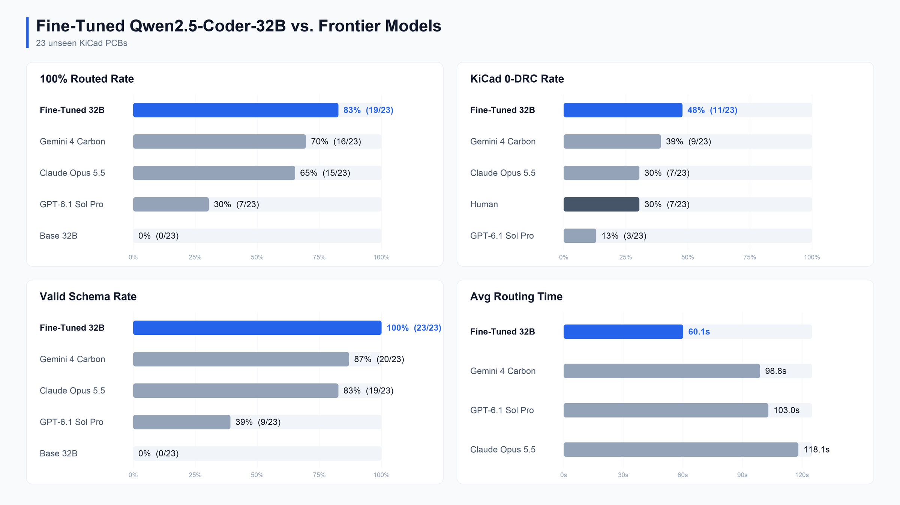

# AI KiCad PCB Architectural Planner (`Qwen2.5-Coder-32B` + SFT/GRPO)

[](https://huggingface.co/Simonssb/qwen2.5-coder-32b-pcb-grpo)

An open-weight **32B LoRA adapter** (`Qwen/Qwen2.5-Coder-32B-Instruct` fine-tuned with **Stage-1 QLoRA SFT** + **Stage-2 Online GRPO** on **245 curated open-source KiCad PCB designs**) that learns **architectural PCB layout intuition** before placement and routing begin.

Instead of asking an LLM to hallucinate raw X/Y coordinates, the model takes a compact netlist and footprint geometry summary (`board_context.md`) and outputs:
1. **`groups.json`**: 1-IC-per-group functional partitioning (`core`, `power`, `interface`), anchor selection, and `near` adjacency springs.
2. **`routing_strategy.json`**: Ground/split-plane pours (`ground_plane_nets`), EMI `keep_away_rules`, `power_width_tiers`, laminar `bus_routing`, `placer_channel_reservation`, and `via_and_trace_rules`.

These plans drive deterministic placement and Rust A* autorouting via [`drandyhaas/KiCadRoutingTools`](https://github.com/drandyhaas/KiCadRoutingTools).

---

## 23-Board Blind Benchmark (vs. Frontier Models)

Evaluated blind across **23 unseen KiCad boards** (21 held-out open-source validation boards + 2 custom hydroponics controllers: `AI_Hydro_Controller` and `HydroPCB`) using the exact same `KiCadRoutingTools` placer, Rust A* router, and `kicad-cli pcb drc` gate.



| Model | Boards | Valid Schema | 100% Routed (`0` Blocking) | `0`-DRC Rate | Avg DRC Errors | Avg Copper (mm) | Avg Vias | Avg Rollout Time | Avg Teel (0–100) |
| :--- | :---: | :---: | :---: | :---: | :---: | :---: | :---: | :---: | :---: |
| **Human Ground-Truth PCB** | 23 | - | - | 7/23 (30%) | 8.1 | 1,522 | 80.8 | - | 73.8 |
| **Fine-Tuned Qwen2.5-Coder-32B** | 23 | **23/23 (100%)** | **19/23 (83%)** | **11/23 (48%)** | **5.4** | **1,468** | **64.7** | **60.1s** | **75.2** |
| `gemini-4-carbon` (Zero-Shot) | 23 | 20/23 (87%) | 16/23 (70%) | 9/23 (39%) | 7.6 | 1,497 | 66.4 | 98.8s | 73.2 |
| `claude-opus-5.5` (Zero-Shot) | 23 | 19/23 (83%) | 15/23 (65%) | 7/23 (30%) | 15.9 | 1,522 | 67.9 | 118.1s | 72.6 |
| `gpt-6.1-sol-pro` (Zero-Shot) | 23 | 9/23 (39%) | 7/23 (30%) | 3/23 (13%) | 4.6* | 912* | 33.4* | 103.0s* | 80.6* |
| `qwen-2.5-coder-32b-base` | 23 | 0/23 (0%) | 0/23 (0%) | - | - | - | - | - | - |

*\*`gpt-6.1-sol-pro` averages only reflect the 7 smaller boards it completed; it stalled on 14/23 boards with `"status": "blocked_by_fixed_placement"` and timed out on 2.*

---

## Repository Structure

- `pcb_design_intelligence.py` — Compact `board_context.md` generator, mechanical/RF lock detector, and 19-point John Teel physical quality evaluator (`evaluate_physical_board_quality`).
- `gym_rollout.py` — Local KiCad placement + Rust A* routing physics engine wrapper (`KiCadRoutingTools`).
- `build_sft_dataset.py` & `curate_sft_dataset.py` — Rejection-sampled dataset curation (`393` raw boards -> `245` curated examples: `214` train / `31` val; `274` GRPO prompts).
- `modal_train_sft.py` & `modal_eval_and_grpo.py` — Serverless Modal `A100-80GB` QLoRA SFT and Stage-2 Online GRPO training/inference scripts.
- `run_scaleup_pipeline.py` & `run_eval_and_grpo_pipeline.py` — End-to-end training and held-out blind evaluation orchestrators.
- `benchmark_frontier_vs_finetuned.py` — 23-board benchmark harness (schema validation, `gym_rollout`, `kicad-cli pcb drc`, timing, and Teel scoring).
- `make_benchmark_chart.py` — Generates `runs/frontier_vs_finetuned_chart.png` from `runs/frontier_vs_finetuned_summary.json`.
- `runs/frontier_vs_finetuned_leaderboard.md` — Full per-board breakdown across all 23 boards.

---

## Quickstart

### 1. Prerequisites
- **KiCad 9 or 10** (with `kicad-cli` available)
- **[KiCadRoutingTools](https://github.com/drandyhaas/KiCadRoutingTools)** cloned and built (update `KRT_ROOT` in `gym_rollout.py` / `run_eval_and_grpo_pipeline.py` if not at `~/.gemini/config/tools/KiCadRoutingTools`)
- **Python 3.10+** with `numpy`, `pillow`, and `modal` (for cloud GPU training/inference)

### 2. Run Inference with the Hugging Face Adapter
Download the LoRA adapter from [`Simonssb/qwen2.5-coder-32b-pcb-grpo`](https://huggingface.co/Simonssb/qwen2.5-coder-32b-pcb-grpo):

```python
from peft import PeftModel
from transformers import AutoModelForCausalLM, AutoTokenizer
import torch

base_id = "Qwen/Qwen2.5-Coder-32B-Instruct"
adapter_id = "Simonssb/qwen2.5-coder-32b-pcb-grpo"

tokenizer = AutoTokenizer.from_pretrained(adapter_id, trust_remote_code=True)
base = AutoModelForCausalLM.from_pretrained(base_id, torch_dtype=torch.bfloat16, device_map="auto")
model = PeftModel.from_pretrained(base, adapter_id)
```

### 3. Place & Route a KiCad Board
```bash
python3 gym_rollout.py \
  --board HydroPCB \
  --set sethydro \
  --mode rollout \
  --groups path/to/pred_groups.json \
  --routing-strategy path/to/pred_routing_strategy.json \
  --production-finish
```

### 4. Reproduce the 23-Board Benchmark
```bash
python3 benchmark_frontier_vs_finetuned.py --prepare
python3 benchmark_frontier_vs_finetuned.py --eval
python3 make_benchmark_chart.py
```

### 5. Retrain from Scratch (Modal A100-80GB)
```bash
modal run modal_train_sft.py \
  --base-model Qwen/Qwen2.5-Coder-32B-Instruct \
  --train-file dataset/sft_curated_train.jsonl \
  --val-file dataset/sft_curated_val.jsonl
```
